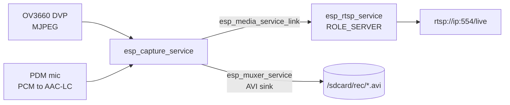

# ESP32-S3 A/V Streamer

A Seeed XIAO ESP32-S3 Sense on a home LAN. The board streams MJPEG video and
AAC-LC audio over RTSP at `rtsp://<board-ip>:554/live`, records AVI files to a
FAT32 SD card, and serves the card and a JSON status document over HTTP. The
HTTP server is read-only and has no authentication, so keep it on the local
network.

## Stack

| Layer | Choice |
|---|---|
| SoC | ESP32-S3R8, 8 MiB octal PSRAM, 8 MiB flash, OV3660 DVP camera, PDM mic |
| Media | Espressif ADF/GMF: `esp_capture_service`, `esp_rtsp_service` (MJPEG + AAC-LC), optional `esp_muxer_service` (AVI) |
| HTTP | Hand-written HTTP/1.1 on the board's `std` sockets, JSON plus byte-range file bodies |
| Language | Rust (`std`, ESP-IDF target `xtensa-esp32s3-espidf`) |
| Bindings | `esp-idf-sys` bindgen over the C headers. No C or C++ shim source |
| Storage | FAT32 only, one mount at `/sdcard`, one boot qualification battery |

The HTTP server is not `EspHttpServer`. The IDF server does not publish a
`Content-Length` while a body is still streaming and has no `Range` support, so
a large recording could not be resumed or sized in advance.

## Layout

```text
firmware/   cargo workspace for the xtensa target
  src/        main.rs, app.rs, settings.rs, selftest.rs
  components/ logging, net, storage, media, fileserver
  api/        openapi.json, the API contract served by the board
  docs/       architecture.md, failure-modes.md, adr-0001-packetization.md
harness/    separate cargo workspace for the host: analysis, RTSP client, contract tests
scripts/    build, flash, monitor and device-test entry points
```

Each workspace pins its own `.cargo/config.toml` and `rust-toolchain.toml`, so a
host test never inherits the ESP target.

## Firmware Architecture

`main.rs` spawns a 64 KiB runtime thread and hands control to `app::run`. The
boot path brings up the network interface, takes the peripherals, probes and
mounts the SD card, joins Wi-Fi, waits for a station address, starts the file
server once, starts the media pipeline, and prints one line:

```text
boot: ready rtsp=rtsp://<ip>:554/live http://<ip>:80/ recording=<on|off> audio=<on|off> capture=<w>x<h>@<fps>fps
```

A failed store, network or server does not stop the rest; only a peripherals
failure is fatal. Full detail is in `firmware/docs/architecture.md`.

The media path is the vendor GMF pipeline. Rust configures it, and frames stay
in vendor buffers:



Reusable crates: `firmware/components/{logging,net,storage,media,fileserver}`.

### Capture geometry

Sizes are fixed by the DVP source; anything else falls back to QVGA. Measured
with the sensor at 10 MHz:

| Size | Video | Stability |
|---|---|---|
| 320x240 | 10 fps | stable |
| **640x480 (default)** | ~8-9 fps, 0 corrupt | stable for 60 s, audio 60.0 s |
| 1024x768 | 4.3 fps | capture stalls after ~18 s |
| 1280x720 | 1-2.4 fps | stalls after 4-11 s |
| 1920x1080 | 1.36 fps, 8.6 Mbps | audio starves after ~8 s |

Full HD is configurable and really does deliver 1080p frames, but the capture
sync cannot sustain it, so VGA is the default. At 20 MHz the sensor emits ~74%
corrupt VGA JPEGs (green or coloured bands), so the DVP clock stays at 10 MHz.

### Audio

AAC-LC, **48 kHz mono, 64 kb/s**, RTP payload type 97:

```text
m=audio 0 RTP/AVP 97
a=rtpmap:97 MPEG4-GENERIC/48000/1
a=fmtp:97 mode=AAC-hbr; indexlength=3; sizelength=13; config=1188; streamtype=5
```

G.711 was the first choice, but static payload type 0 pins the clock to 8 kHz by
RFC 3551 and the 8-bit companding was audible as hiss at the mic's low level.
The `audio_track_is_wideband_aac` test in `components/media` guards the codec
and rate.

### Recording

AVI recording is compiled in by default and is selected at run time with
`RECORD_MODE`:

| Mode | RTSP | AVI recording |
|---|---|---|
| `both` (default) | on | on |
| `stream` | on | off |
| `record` | off | on |

The vendor muxer writes segments below `/sdcard/rec` and names them
`muxed_0.avi`, `muxed_1.avi` and so on, derived from the storage directory and
the slice index. Take the exact name from `/api/v1/files`. Recording requires a
mounted card; without one the boot line reports `recording=off` and streaming
continues. `--no-default-features` drops the `avi-recording` feature and all
muxer code.

Recording while streaming is the default mode, but it is not yet proven on
hardware. If the vendor muxer starves the RTSP sink, use `RECORD_MODE=stream` to
stream or `RECORD_MODE=record` to capture. See Known Limitations.

## HTTP API

The server answers one request per connection on port 80. It is read-only
and JSON only.

| Method | Path | Body |
|---|---|---|
| `GET` | `/` | JSON index of the endpoints below |
| `GET` | `/api/v1/status` | device status object |
| `GET` | `/api/v1/files` | `{"files":[{"path":"/rec/muxed_0.avi","size":123456}]}` |
| `GET` | `/api/v1/openapi.json` | the OpenAPI 3.0.3 document |
| `GET`, `HEAD` | `/api/v1/files/{path}` | one file, whole or ranged |

`/api/v1/files` lists the entries directly below `/sdcard/rec`, sorted by name,
at most 200. A download sets an exact `Content-Length` and
`Accept-Ranges: bytes`; a single `Range` header gets `206` with `Content-Range`,
and an unsatisfiable range gets `416` with `Content-Range: bytes */<total>` and
no body. Path traversal, backslashes, NUL bytes and bad escapes are rejected
with `404`.

The status object always carries the same 17 properties:

```text
version build uptime_s ip hostname mounted total_bytes free_bytes clock_khz
rtsp_port rtsp_path rtsp_running recording_enabled recording_file temperature_c
heap_internal_free heap_spiram_free
```

`recording_file` and `temperature_c` are nullable. The document is built from a
fresh device snapshot: it lists the mount and the `<mount>/rec` directory once
but never reads file contents, so it also answers on a card-less boot.
`firmware/api/openapi.json` is the contract, and the board serves the same bytes
from `include_str!`.

Two requests that work against the board now:

```bash
curl -s http://192.168.1.33/api/v1/status
curl -s http://192.168.1.33/api/v1/files
```

The board used for this documentation run is on `192.168.1.33`; it cannot read
its SD card, so the second command returns `{"files":[]}` there. That is a
current datapoint, not the API design.

Once a card has recordings, fetch one (requires the board and a mounted card):

```bash
curl -o muxed_0.avi http://<board-ip>/api/v1/files/rec/muxed_0.avi
curl -C - -o muxed_0.avi http://<board-ip>/api/v1/files/rec/muxed_0.avi
curl -r 0-1023 -o first-kib.bin http://<board-ip>/api/v1/files/rec/muxed_0.avi
```

`muxed_0.avi` is the first segment the vendor muxer writes; get the exact name
from `/api/v1/files`. If the first transfer is interrupted, the second resumes
it. The third asks for the first KiB and expects `206` with
`Content-Range: bytes 0-1023/<total>`.

The server has one accept thread and one worker. When the worker is busy a new
connection is refused at once with `503` and a JSON error, so a status request
that arrives during a download gets `503` rather than waiting behind it. Each
connection has a 10 s read timeout, a 10 s write timeout and an 8 KiB
request-head cap. The server declines to start when fewer than 64 KiB of
internal SRAM remain after its own stacks.

## Configuration

Non-secret build knobs live in the `[env]` table of
`firmware/.cargo/config.toml` and are read with `option_env!` in
`firmware/src/settings.rs`:

| Key | Default |
|---|---:|
| `VIDEO_WIDTH` | 640 |
| `VIDEO_HEIGHT` | 480 |
| `VIDEO_FPS` | 10 |
| `VIDEO_JPEG_QUALITY` | 12 |
| `AUDIO_SAMPLE_RATE` | 48000 |
| `AUDIO_BITRATE` | 64000 |
| `FILE_SERVER_PORT` | 80 |
| `RECORD_MODE` | both |

A plain `cargo build` resolves every one of them. Precedence, highest first,
is: a key defined in `.env` (the build script sources it and forwards it),
a key exported in the calling shell, the `[env]` table, then the compiled
default. Change a numeric knob by editing the `[env]` table, or by putting the
key in `.env`, which wins over the table. A knob that `.env` does not define can
be overridden for one build through Cargo:

```bash
./scripts/build-firmware.sh --config 'env.RECORD_MODE="record"'
```

`settings::parse_u32` treats an empty value, a non-digit, an overflow or `0` as
absent and uses the default. It accepts a leading `+` and does not trim
whitespace. JPEG quality is clamped to 0..=63. An unknown `RECORD_MODE` falls
back to `both` and logs a boot warning.

Wi-Fi credentials are the exception. `WIFI_SSID` and `WIFI_PASSWORD` are
compile-time secrets, supplied by `scripts/build-firmware.sh` from a gitignored
`.env` at the repository root. `.env.example` is the tracked template: it lists
every key and leaves the two secret values empty. No credential is committed,
and no `.env` parser runs in `build.rs`: the keys are read with `option_env!`. A
build without them still links, warns, and boots with the network disabled.

## Build, Flash, Connect

`scripts/build-firmware.sh` is the single build entry point. It sets up the
`esp` toolchain and libclang, sources `.env` when present, and forwards the
credentials and knobs. `scripts/flash.sh` calls it, so a flash cannot silently
drop the credentials.

```bash
./scripts/build-firmware.sh          # build the firmware
./scripts/flash.sh [PORT]            # build, then flash ELF + partition table
./scripts/monitor.sh [PORT]          # serial console (resets the board)
ffplay -rtsp_transport tcp rtsp://<board-ip>:554/live
```

Flash, monitor and ffplay need the board attached. The flash includes
`partition-table.bin`; flashing the ELF alone keeps whatever layout is already
in flash. The boot log prints the readiness line quoted above, and
`firmware/api/openapi.json` describes every HTTP response.

## Test Runners

| Runner | Command | Runs on | Covers |
|---|---|---|---|
| Host suite | `./scripts/test-harness.sh` | host | settings parsing, net policy, fileserver pure logic and in-process contract, RTSP SDP parser, analyser |
| Device unit/HIL gate | `./scripts/run-device-tests.sh --timeout-seconds 300` | board (serial) | six test binaries; pass signal is `VERDICT 0` |
| Live API contract | `ESP32_BOARD_URL=http://<board-ip> ./harness/api_contract.sh` | host + board | every endpoint validated against `openapi.json`; pass signal is `CONTRACT PASS` |
| In-process contract | `cd harness && cargo test --test api_contract` | host | the same assertion set without a board (live driver skips) |
| Stream quality | `./harness/stream_quality.sh` | host + board | flash, record 60 s, artefact metrics |

The device gate builds `cargo test --no-run --workspace`, flashes each test
binary serially and requires one clean `test result: ok.` line per binary. It
exits non-zero on a test failure, a timeout, an idle serial log, a reset, or a
missing result line. The last recorded run did not complete; see Known
Limitations.

Long-running checks (need the board):

```bash
./harness/stress_test.sh --minutes 60     # one recording per minute, scan the device log
./harness/resolution_matrix.sh            # sizes and JPEG quality, measured
```

Recordings are kept for inspection: `stream_quality.sh` writes to
`harness/artifacts/stream-quality/<timestamp>/`, and the integration tests to
`harness/artifacts/<test>/` (`stream.mkv`, `video.mjpeg`, `audio.wav`,
`metrics.json`). That directory is gitignored.

Device tests also run from the Test Explorer: `scripts/device-test-runner.sh`
flashes the binary, streams libtest output and exits with the device result. A
click costs one flash (~40 s), and the whole binary runs because filters do not
reach `app_main`.

## Devcontainer

The `espressif/idf-rust:esp32s3_latest` image ships the Xtensa Rust toolchain
but no ESP-IDF, so `containerfile` installs ESP-IDF v5.5.2 (`/opt/esp/idf`,
tools in `/opt/esp/idf-tools`), ffmpeg and serial diagnostics. Environment:
`IDF_PATH`, `IDF_TOOLS_PATH`, `RUSTUP_HOME=/home/esp/.rustup`,
`CARGO_HOME=/home/esp/.cargo`. `/dev` is bind-mounted so `ttyACM*` appears
without restarting the container.

After changing `containerfile` or `devcontainer.json`, rebuild the dev container
(the first build clones IDF, so it is slow). rust-analyzer analyses both
workspaces through `rust-analyzer.linkedProjects`.

## Known Limitations

- **Recording during streaming is not proven on hardware.** `RECORD_MODE=both`
  is the default, but whether the vendor AVI sink starves the RTSP sink, or
  leaves an empty file, has not been measured. `RECORD_MODE=stream` and
  `RECORD_MODE=record` are the documented fallbacks.
- **The HTTP download path has not carried a real recording.** The range, path,
  chunking and status logic pass the host suite, but the card on the test board
  does not mount, so the live file list is empty and no file has been fetched
  over the network.
- **The device gate is not clean.** The last recorded device run ended in a task
  stack overflow, and the runs that needed the card could not mount it. No
  device run has produced `VERDICT 0`; the only `VERDICT 0` on record is the
  runner's synthetic self-test.
- **The SD card is stuck on the test board.** The raw probe still identifies it
  (`CMD8` returns SDv2) but `ACMD41` times out on every boot, so the volume does
  not mount. A physical re-seat or power-cycle is required.
- **`clock_khz` on a mounted card is unverified.** It reads the SDMMC host slot
  after a successful mount, and this firmware mounts through SDSPI. On a
  card-less boot the field is safely `0`.
- Sizes above 640x480 configure successfully but the capture pipeline stalls
  (see the geometry table), so they are not usable for a live stream yet.
- The PDM path has no codec chip, so `esp_codec_dev` gain control is a no-op.
  The mic level is what the sensor delivers (peaks around -17 dBFS), which is
  why the harness reports the audio as quiet but not silent.
- The HTTP server is read-only, unauthenticated and has no TLS. Keep it on the
  local network.
- Device tests, flashing and the live capture require the board attached.
