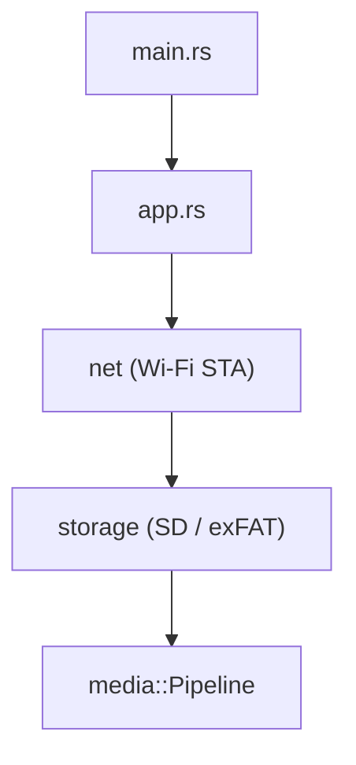
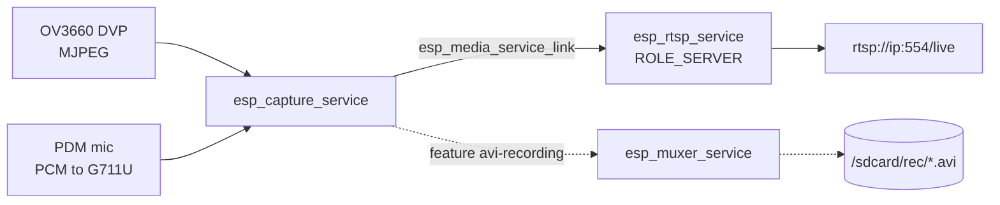
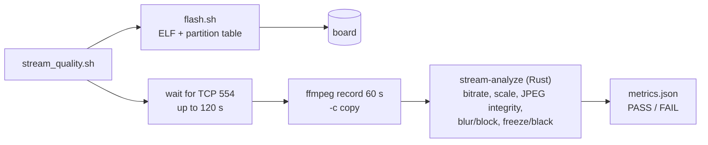
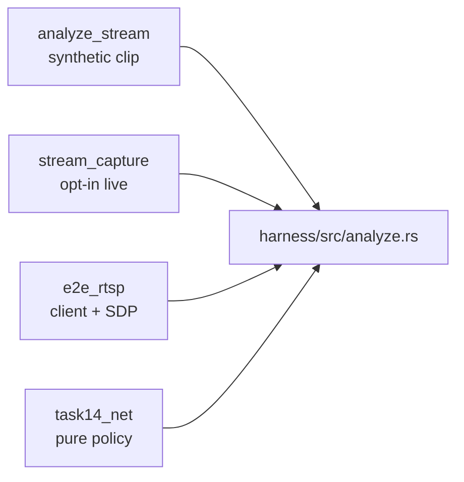

# ESP32-S3 A/V Streamer

XIAO ESP32-S3 Sense as a LAN RTSP server: MJPEG video + G.711 µ-law audio, plus
optional SD recording. The board is the server; a client pulls
`rtsp://<board-ip>:554/live`.

## Stack

| Layer | Choice |
|---|---|
| SoC | ESP32-S3R8, 8 MiB octal PSRAM, 8 MiB flash, OV3660 DVP camera, PDM mic |
| Media | Espressif **ADF / GMF**: `esp_capture_service`, `esp_rtsp_service` (one stream, MJPEG + AAC), optional `esp_muxer_service` (AVI) |
| Language | **Rust** (`std`, ESP-IDF target `xtensa-esp32s3-espidf`) |
| Bindings | `esp-idf-sys` bindgen over the C headers; **no C or C++ shim** |
| FS | FatFs exFAT (patched at build time), `f_mkfs` for on-device format |

## Layout

```
firmware/   own cargo workspace: xtensa target, ESP-IDF, components/*, sdkconfig
harness/    own cargo workspace: host x86_64, stream capture + analysis
scripts/    build / flash / device-test entry points
docs:       firmware/docs/architecture.md, failure-modes.md
```

Each workspace pins its own `.cargo/config.toml` and `rust-toolchain.toml`, so
host tests never inherit the ESP target.

## Firmware Architecture

`main.rs` (24 lines) starts `app.rs`, which brings up the platform and hands
control to the media pipeline:



`media::Pipeline` links Espressif services; frames never pass through Rust:



Reusable Rust crates: `firmware/components/{logging,net,storage,media}`.

### Capture geometry

Sizes are fixed by the DVP source; anything else silently falls back to QVGA.
Measured with the sensor at 10 MHz:

| Size | Video | Stability |
|---|---|---|
| 320×240 | 10 fps | stable |
| **640×480 (default)** | ~8-9 fps, 0 corrupt | stable for 60 s, audio 60.0 s |
| 1024×768 | 4.3 fps | capture stalls after ~18 s |
| 1280×720 | 1-2.4 fps | stalls after 4-11 s |
| 1920×1080 | 1.36 fps, 8.6 Mbps | audio starves after ~8 s |

Full HD is configurable and really does deliver 1080p frames, but the capture
sync cannot sustain it, so VGA is the default. The DVP clock is 10 MHz; at
20 MHz the sensor emits ~74% corrupt VGA JPEGs (green/coloured bands).

### Audio

AAC-LC, **48 kHz mono, 64 kb/s**, RTP payload type 97:

```
m=audio 0 RTP/AVP 97
a=rtpmap:97 MPEG4-GENERIC/48000/1
a=fmtp:97 mode=AAC-hbr; indexlength=3; sizelength=13; config=1188; streamtype=5
```

G.711 was the first choice but PT 0 pins the clock at 8 kHz by RFC 3551, and
8-bit companding was audible as hiss at the mic's low level. The RTSP service
maps only G.711 and AAC (Opus has no server-side mapping), so AAC is the only
wideband option. `audio_track_is_wideband_aac` in `components/media` guards the
codec/rate.

## Harness Architecture

Host-side tooling that drives the real board and measures the result:



Host tests (`harness/`) exercise the same analysis code plus a live RTSP client:



## Devcontainer

The `espressif/idf-rust:esp32s3_latest` image ships the Xtensa **Rust**
toolchain but no ESP-IDF (its layer history only adds Debian, `rustup` and
`espup`), so the containerfile installs ESP-IDF v5.5.2 (`/opt/esp/idf`, tools
in `/opt/esp/idf-tools`), ffmpeg and serial diagnostics. Environment (set in `containerEnv`):
`IDF_PATH`, `IDF_TOOLS_PATH`, `RUSTUP_HOME=/home/esp/.rustup`,
`CARGO_HOME=/home/esp/.cargo`. `/dev` is bind-mounted so `ttyACM*` appears
without restarting the container.

After changing `containerfile`/`devcontainer.json`: **Dev Containers: Rebuild
Container** (the first build clones IDF, so it is slow). rust-analyzer analyses
both workspaces via `rust-analyzer.linkedProjects`.

## Test Runners

| Runner | Command | Runs on | Covers |
|---|---|---|---|
| Host tests | `./scripts/test-harness.sh` | host | analyzer, RTSP client, net policy |
| Device unit tests | `./scripts/run-device-tests.sh` | board (serial) | 54 tests in 5 binaries |
| Stream quality | `./harness/stream_quality.sh` | host + board | record 60 s, artefact metrics |
| Test Explorer | rust-analyzer | both | host tests instant; device tests flash per click |

Long-running checks:

```bash
./harness/stress_test.sh --minutes 60     # 1 h, one file per minute, device log scan
./harness/resolution_matrix.sh            # sizes x JPEG quality, measured
```

Recordings are kept for inspection: `stream_quality.sh` writes to
`harness/artifacts/stream-quality/<timestamp>/`, and the integration tests to
`harness/artifacts/<test>/` (`stream.mkv`, `video.mjpeg`, `audio.wav`,
`metrics.json`). The directory is gitignored.

Device tests are also runnable from the Test Explorer: the cargo runner
(`scripts/device-test-runner.sh`) flashes the test binary, streams libtest
output and exits with the device result. The device runs every test in a
binary (filters do not reach `app_main`), and a click costs one flash (~40 s).

## Build, Flash, Connect

```bash
./scripts/build-firmware.sh          # VIDEO_WIDTH=320 VIDEO_HEIGHT=240 ...
./scripts/flash.sh [PORT]            # flashes ELF + partition table
./scripts/monitor.sh [PORT]          # serial console (add --after no-reset to keep it running)
./harness/stream_quality.sh          # flash, wait, record 60 s, analyse
ffplay -rtsp_transport tcp rtsp://<board-ip>:554/live
```

The serial log prints the address: `boot: RTSP advertising <ip>:554`, followed
by `boot: ready recording=… audio=… rtsp=…` and `selftest: PASS`.

Flashing must include the partition table; `espflash flash <elf>` alone keeps
the previous layout in flash.

## Configuration

`.env` at the repository root holds `WIFI_SSID` / `WIFI_PASSWORD` and is
committed so builds are reproducible; `firmware/build.rs` embeds them. Add no
other secret there.

## Known Limitations

- **AVI recording is gated off** (`avi-recording`, default off): the
  `esp_muxer_service` sink requests the capture provider's global cache, which
  starves the RTSP video sink, and the file stays empty. The cause is inside
  the vendor sink.
- Sizes above 640×480 configure successfully but the capture pipeline stalls
  (see the geometry table), so they are not usable for a live stream yet.
- The PDM path has no codec chip, so `esp_codec_dev` gain control is a no-op;
  the mic level is what the sensor delivers (peaks around −17 dBFS), which is
  why the harness reports the audio as "quiet" but not silent.
- Device tests, flashing and the live capture require the board attached.
